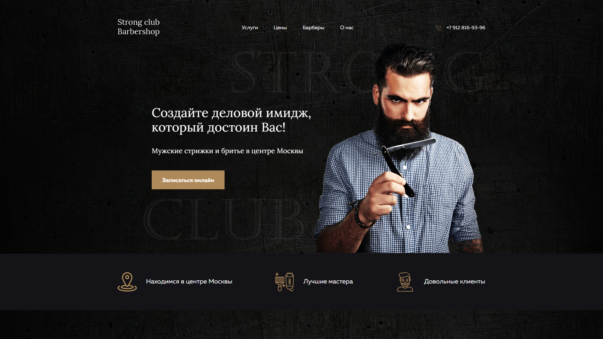
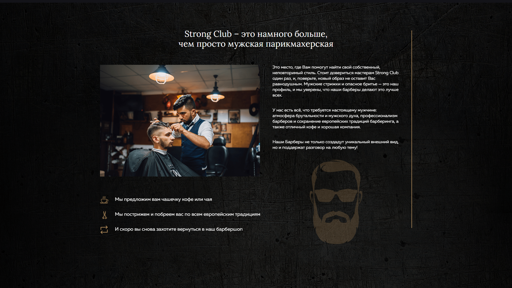
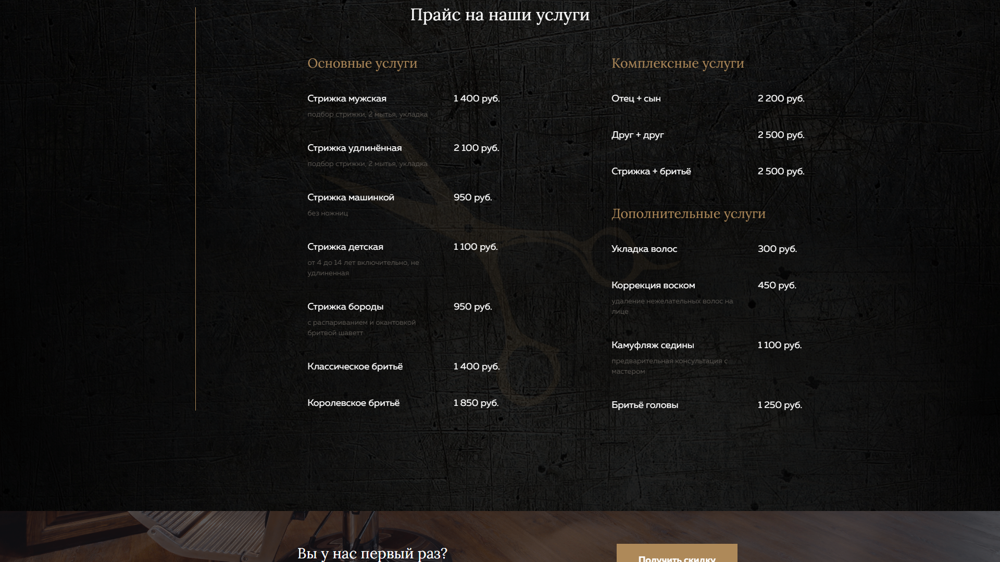
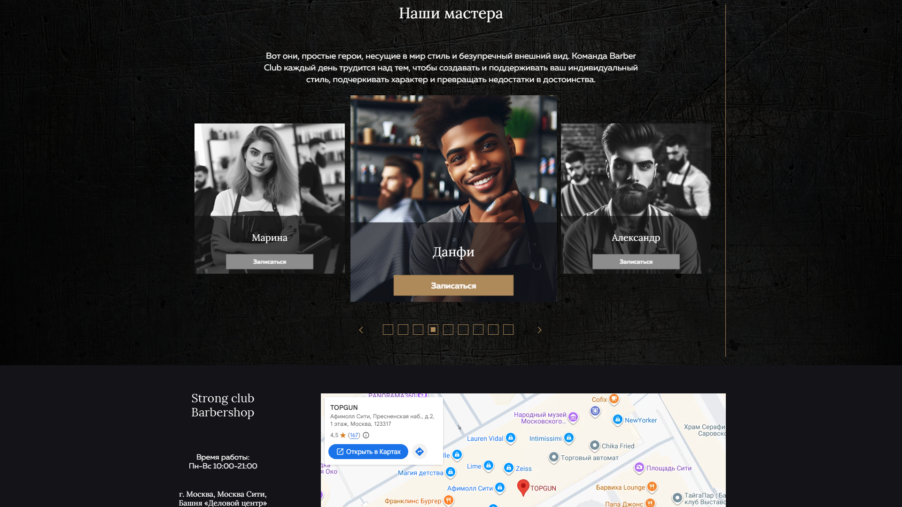
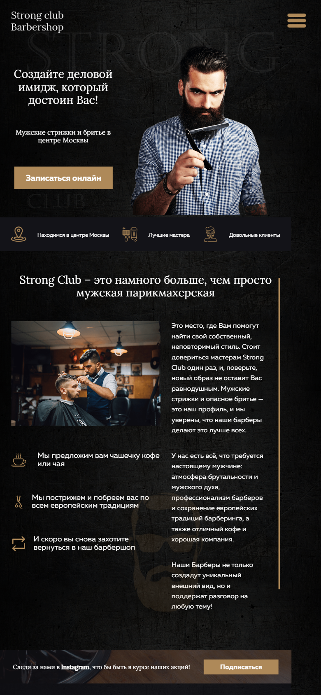

<p align="center">
  
</p>

<p align="center">
  <b>Лендинг мужского барбершопа: прайс на услуги, слайдер мастеров и онлайн-запись с выбором даты и времени.</b>
</p>

<p align="center">
  
  
  
  
  <a href="https://dekciw.github.io/StrongClubBarbershop/"></a>
</p>

<p align="center">
  <a href="https://dekciw.github.io/StrongClubBarbershop/">
    
  </a>
</p>

<br>

<p align="center">
  
</p>

<br>

<table align="center">
  <tr>
    <th>&#8199;&#8199;&#8199;&#8199;&#8199;&#8199;Разделы&#8199;&#8199;&#8199;&#8199;&#8199;&#8199;</th>
    <th>&#8199;&#8199;&#8199;&#8199;&#8199;&#8199;Запись&#8199;&#8199;&#8199;&#8199;&#8199;&#8199;</th>
    <th>&#8199;&#8199;&#8199;&#8199;&#8199;&#8199;Вёрстка&#8199;&#8199;&#8199;&#8199;&#8199;&#8199;</th>
  </tr>
  <tr>
    <td valign="top">
      - О барбершопе<br>
      - Прайс на 14 услуг<br>
      - Скидка 15% новым гостям<br>
      - Слайдер мастеров<br>
      - Карта и контакты<br>
      - Анимации при прокрутке
    </td>
    <td valign="top">
      - Выбор услуги и мастера<br>
      - Календарь для даты<br>
      - Выбор времени<br>
      - Маска телефона<br>
      - Ошибки под каждым полем<br>
      - Отправка на тестовый сервер
    </td>
    <td valign="top">
      - Адаптив до 320 px<br>
      - Мобильное меню<br>
      - Стили на Sass<br>
      - Сборка CSS через Gulp<br>
      - jQuery и плагины<br>
      - Сайт на GitHub Pages
    </td>
  </tr>
</table>

<h3 align="center">Как это выглядит</h3>

<table align="center">
  <tr>
    <td width="50%" align="center" valign="top">
      <br>
      <sub>О барбершопе</sub>
    </td>
    <td width="50%" align="center" valign="top">
      <br>
      <sub>Прайс на услуги</sub>
    </td>
  </tr>
  <tr>
    <td width="50%" align="center" valign="top">
      <br>
      <sub>Мастера</sub>
    </td>
    <td width="50%" align="center" valign="top">
      <br>
      <sub>Мобильная версия</sub>
    </td>
  </tr>
</table>

<br>

<details>
<summary><b>Подробнее о проекте: стек, устройство, запуск</b> (нажми, чтобы развернуть)</summary>

<br>

### Стек

<p>
- <b>Вёрстка:</b> HTML и Sass (SCSS), стили собираются Gulp в <code>dist/style.min.css</code><br>
- <b>Скрипты:</b> jQuery, jQuery UI, Masked Input для телефона<br>
- <b>Плагины:</b> Slick для слайдера мастеров, Air Datepicker для даты, WOW.js и Animate.css для анимаций
</p>

### Структура

```
.
├── index.html              # вся страница
├── gulpfile.js             # сборка SCSS в один минифицированный CSS
├── dist/style.min.css      # готовые стили, которые подключает страница
├── src/
│   ├── styles/             # исходники SCSS: основа, адаптив, кнопки, плагины
│   ├── scripts/index.js    # меню, прокрутка, слайдер, календарь, проверка и отправка формы
│   ├── scripts/            # jQuery и плагины
│   ├── images/             # фото, иконки и логотип
│   ├── fonts/              # шрифты
│   └── slick/              # стили слайдера
└── screenshots/            # скриншоты для README
```

### Как работает запись

Кнопка «Записаться» у мастера открывает форму. Все поля обязательны: если что-то не заполнено, под полем появляется подсказка. Заполненная форма отправляется на учебный сервер `testologia.ru`, после ответа показывается благодарность.

### Запуск

Откройте `index.html` в браузере, сборка не нужна: готовый CSS уже лежит в `dist/`. Чтобы пересобрать стили после правок в SCSS:

```bash
npm install
npx gulp
```

</details>
